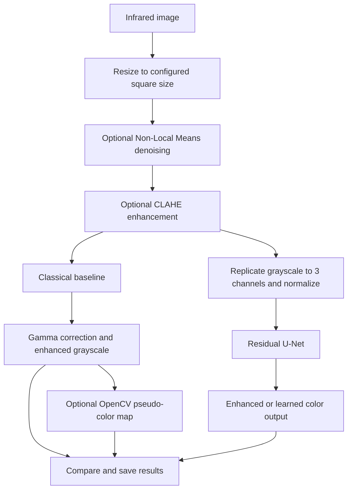

# Infrared Image Enhancement & Colorization

A Python and PyTorch project for improving the readability of thermal/infrared images through classical image processing and a trainable deep-learning model. It provides a baseline enhancement pipeline, an optional pseudo-color view, a Residual U-Net generator, a Gradio demo, training and inference scripts, and image-quality evaluation utilities.

> **Project context:** Developed for ISRO Hackathon — Problem Statement 10: Infrared Image Colorization & Enhancement.
>
> **Current status:** Research/prototype code. The repository contains no sample dataset and no pretrained model checkpoint. You can run the classical baseline immediately after installing dependencies; deep-model inference requires a checkpoint trained for your data.

## Why this project?

Thermal cameras record infrared intensity rather than ordinary visible-light color. Their images can be noisy or low in contrast, making boundaries and objects difficult to interpret. This project provides two ways to process an image:

- **Classical enhancement:** denoising, local-contrast enhancement with CLAHE, and gamma correction. This path does not require training.
- **Deep-learning enhancement or colorization:** a Residual U-Net learns an image-to-image mapping from the supplied training data. With correctly paired RGB targets, it can be trained for colorization; without paired RGB targets, it can learn the project's classical enhancement target.

The project is designed to prioritize structural similarity and boundary preservation. This is a design objective, not a guarantee that every output preserves every real-world detail. Inspect generated images against the source before using them to support operational decisions.

## What you can do

- Upload an infrared image in the interactive Gradio demo and compare the classical results with the deep-model output.
- Enhance images using the classical pipeline without training a neural network.
- Apply an OpenCV pseudo-color map to make intensity patterns easier to view.
- Train a Residual U-Net on your own infrared dataset, either with paired RGB targets or in the project's self-supervised enhancement mode.
- Optionally enable conditional GAN training with a PatchGAN discriminator.
- Run inference on one image or on images in a directory.
- Evaluate trained-model outputs with PSNR, SSIM, LPIPS, and edge-consistency metrics.
- Review training losses and generated examples with TensorBoard logs and saved checkpoints.

## Key features

| Feature | What it provides |
|---|---|
| Classical baseline | Non-Local Means denoising, CLAHE local-contrast enhancement, gamma correction, and optional pseudo-color visualization |
| Residual U-Net | Encoder-decoder image translation with residual blocks and skip connections |
| Paired-data colorization | Learns a mapping from infrared input to a matching RGB target when correctly paired files are supplied |
| Self-supervised enhancement | Uses a stronger CLAHE-transformed infrared image as the training target when paired RGB data is not used |
| Optional conditional GAN | Adds a PatchGAN discriminator and least-squares adversarial loss when enabled in the configuration |
| Structure-aware losses | Combines pixel, structural-similarity, and edge losses; VGG16 perceptual loss is used for three-channel output |
| Interactive demo | Gradio interface with classical grayscale, pseudo-color, and deep-model panels |
| Batch inference | Processes a single image or supported images directly inside a folder |
| Evaluation report | Writes per-image metrics to CSV and prints mean scores |
| Configurable experiments | Keeps core paths, model settings, training parameters, and output locations in one YAML file |
| Reproducibility support | Seeds Python, NumPy, and PyTorch and enables deterministic cuDNN settings |
| CPU/GPU selection | Uses CUDA when available and requested; otherwise falls back to CPU |

## How the pipeline works



The default image size is **256 × 256 pixels**. The current preprocessing resizes images to a square, so the original aspect ratio is not preserved. Pseudo-color maps are visualization aids: they do **not** represent true visible-light colors or calibrated temperature values.

## Technology stack

- **Language:** Python 3.10+
- **Deep learning:** PyTorch and torchvision
- **Image processing:** OpenCV, Pillow, NumPy, scikit-image
- **Data augmentation:** Albumentations
- **Demo interface:** Gradio
- **Metrics:** scikit-image and LPIPS
- **Training visualization:** TensorBoard
- **Configuration:** YAML with PyYAML

## Repository structure

```text
project/
├── app/
│   └── app.py                 # Gradio upload-and-compare demo
├── configs/
│   └── config.yaml            # Dataset, model, training and output settings
├── data/
│   ├── raw/
│   │   ├── train/
│   │   │   ├── ir/            # Training infrared images
│   │   │   └── rgb/           # Optional paired RGB targets
│   │   └── val/
│   │       ├── ir/            # Validation infrared images
│   │       └── rgb/           # Optional paired validation targets
│   ├── dataset.py             # PyTorch dataset and target selection
│   └── preprocessing.py      # Resize, denoise, CLAHE, gamma and normalization
├── models/
│   ├── baseline.py            # Classical enhancement baseline
│   ├── unet.py                # Residual U-Net generator
│   ├── discriminator.py       # Optional conditional PatchGAN
│   └── losses.py              # Pixel, SSIM, edge, perceptual and GAN losses
├── train/
│   └── train.py               # Training and validation loop
├── infer/
│   └── infer.py               # Inference for an image or directory
├── eval/
│   └── evaluate.py            # Metrics and CSV export
├── utils/
│   ├── config.py              # YAML configuration and device selection
│   ├── seed.py                # Random-seed helpers
│   └── io_utils.py            # Checkpoint and image I/O
├── checkpoints/               # Generated model checkpoints
├── outputs/
│   ├── inference/              # Generated inference images
│   ├── logs/                   # TensorBoard event files
│   └── samples/                # Training sample outputs
├── requirements.txt
└── README.md
```

## Getting started

### Prerequisites

- Python **3.10 or newer**
- `pip` and Python's virtual-environment support
- Internet access on first use if pretrained VGG16 or LPIPS weights need to be downloaded
- An NVIDIA GPU with a compatible CUDA-enabled PyTorch installation is recommended for training, but CPU execution is supported and may be slower

### 1. Clone the repository

After this README has been added to your GitHub repository, clone it and enter the directory containing `requirements.txt`:

```bash
git clone https://github.com/OWNER/REPOSITORY.git
cd REPOSITORY
```

Replace `OWNER/REPOSITORY` with the actual GitHub path. Run all project commands from the repository root so that the relative paths in `configs/config.yaml` resolve correctly.

### 2. Create an environment and install dependencies

**Windows PowerShell**

```powershell
py -3.10 -m venv .venv
.\.venv\Scripts\Activate.ps1
python -m pip install --upgrade pip
pip install -r requirements.txt
```

**Linux / macOS**

```bash
python3 -m venv .venv
source .venv/bin/activate
python -m pip install --upgrade pip
pip install -r requirements.txt
```

For GPU training, make sure the installed PyTorch build is compatible with your installed NVIDIA driver and CUDA environment. Use the official PyTorch installation selector if you need a specific CUDA build.

## Prepare your dataset

The archive includes empty placeholder directories only. Add your own images using this layout:

```text
data/raw/
├── train/
│   ├── ir/
│   │   ├── image_001.png
│   │   └── image_002.png
│   └── rgb/                 # Optional; see target-mode notes below
│       ├── image_001.png
│       └── image_002.png
└── val/
    ├── ir/
    │   └── image_101.png
    └── rgb/                 # Optional paired validation targets
        └── image_101.png
```

Supported extensions are `.png`, `.jpg`, `.jpeg`, `.tif`, `.tiff`, and `.bmp`. Infrared inputs are loaded as grayscale. When paired RGB targets are used, each target must have the **same filename** as its infrared input and must show the corresponding scene.

### Choose the training target mode carefully

**Paired colorization (requires matched RGB images)**

Keep the `rgb/` directories and place a matching RGB image there for every infrared image used for paired training or validation. The default configuration uses `data.channels_out: 3`.

**Self-supervised enhancement (no paired RGB data)**

The dataset implementation checks whether the `rgb/` directory exists. If it exists but a corresponding RGB file is missing, the code falls back to a grayscale copy of the infrared input rather than the stronger CLAHE target. The ZIP includes empty `rgb/` placeholder folders containing `.gitkeep`, so for self-supervised training, **remove both empty folders entirely**:

```text
data/raw/train/rgb/
data/raw/val/rgb/
```

Do not leave those directories in place when using this mode unless you populate them with properly paired targets. In self-supervised mode, the target is a stronger CLAHE enhancement of the input. This is useful for learning the configured enhancement transform, but it is not independent ground truth and does not teach true scene colorization.

### Dataset recommendations

- Use a training set with at least the configured batch size. The default is `data.batch_size: 8`, and the training loader drops incomplete batches.
- Provide a separate validation set in `data/raw/val/ir/` for meaningful validation. If the validation infrared folder is empty, the training script falls back to using the training dataset for validation.
- Keep image pairs aligned and verify that each IR/RGB pair corresponds to the same scene.
- Use data you are authorized to process and publish.

## Run the project

### 1. Launch the interactive demo

From the repository root:

```bash
python app/app.py
```

Open the local URL printed by Gradio, typically `http://127.0.0.1:7860`.

1. Upload an infrared image.
2. Select a pseudo-color map: `INFERNO`, `JET`, `HOT`, `VIRIDIS`, `MAGMA`, or `PLASMA`.
3. Select **Enhance & Colorize**.
4. Compare the classical enhanced grayscale image, the classical pseudo-color image, and the deep-model panel.

If `checkpoints/unet_best.pt` is missing or cannot be loaded, the demo displays the classical enhancement in the deep-model panel and shows a warning. This is a fallback for demonstration; it is **not** deep-model inference.

### 2. Run the classical baseline without training

The baseline can be called directly from Python:

```python
import cv2
from models.baseline import BaselineEnhancer

enhancer = BaselineEnhancer(size=(256, 256))
image = cv2.imread("sample.png", cv2.IMREAD_GRAYSCALE)

if image is None:
    raise FileNotFoundError("Could not read sample.png")

enhanced = enhancer(image)
pseudo_color_bgr = enhancer.colorize_pseudo(enhanced)

cv2.imwrite("enhanced_grayscale.png", enhanced)
cv2.imwrite("enhanced_pseudo_color.png", pseudo_color_bgr)
```

The pseudo-color result is stored in OpenCV's BGR channel order, which is what `cv2.imwrite` expects.

### 3. Train the deep-learning model

Add your dataset first, verify the target mode, and then run:

```bash
python train/train.py --config configs/config.yaml
```

The default configuration uses a Residual U-Net, 100 epochs, a batch size of 8, and a learning rate of `0.0002`. Edit `configs/config.yaml` to change paths, image size, model depth, batch size, loss weights, or the number of epochs.

To enable conditional GAN training, set this option in `configs/config.yaml`:

```yaml
train:
  use_gan: true
```

This adds the PatchGAN discriminator and adversarial loss to training. It does not remove the need for appropriate training targets.

During training, the script:

- Saves the best generator checkpoint to `checkpoints/unet_best.pt` according to validation loss.
- Saves periodic checkpoints such as `checkpoints/unet_epoch5.pt` at the configured interval.
- Writes sample input, output, and target images under `outputs/samples/`.
- Logs training losses and validation loss under `outputs/logs/` for TensorBoard.

To inspect the logs in a separate terminal, run:

```bash
tensorboard --logdir outputs/logs
```

The checkpoint contains the generator state, epoch, validation loss, and configuration. Optimizer state is not saved, so the checkpoint is not a complete training-resume snapshot.

### 4. Run inference

A trained checkpoint is required for the command-line inference script.

**Single image**

```bash
python infer/infer.py --input path/to/image.png --checkpoint checkpoints/unet_best.pt
```

**Directory of images**

```bash
python infer/infer.py --input path/to/image_folder/ --checkpoint checkpoints/unet_best.pt
```

The directory mode processes supported image files directly inside the specified directory; it does not recursively scan nested folders. You can also pass `--config path/to/config.yaml` to use a different configuration.

For each readable input, the script writes the following files to `outputs/inference/` by default:

| File | Description |
|---|---|
| `{name}_baseline.png` | Classical enhanced grayscale output |
| `{name}_baseline_color.png` | Classical pseudo-color output |
| `{name}_enhanced.png` | Deep-model output |
| `{name}_comparison.png` | Side-by-side image comparison |

The default checkpoint path and output directory can be changed in `configs/config.yaml`.

### 5. Evaluate a trained model

```bash
python eval/evaluate.py --checkpoint checkpoints/unet_best.pt
```

Evaluation runs over the configured validation dataset and writes per-image results to `outputs/eval_results.csv`. It also prints mean scores to the terminal.

| Metric | What it measures in this project | Typical direction |
|---|---|---|
| PSNR | Pixel-level fidelity, calculated on grayscale versions of the prediction and target | Higher is better |
| SSIM | Structural similarity, calculated on grayscale versions of the prediction and target | Higher is better |
| LPIPS | Learned perceptual distance between prediction and target | Lower is better |
| Edge consistency | Normalized agreement between Canny edge maps | Higher is better |

**Interpret metrics in context.** With paired RGB data, the scores compare predictions against the supplied paired targets. In self-supervised mode, the target is generated using CLAHE, so the scores mainly measure agreement with that synthetic target—not independently verified image quality, physical accuracy, or real-world color correctness. No benchmark scores are included in this repository.

## Model and training details

### Residual U-Net generator

The current default generator uses four encoder/decoder levels and a base channel width of 64. Residual blocks process features at each level, and skip connections carry encoder features into the decoder to retain spatial information. The final layer uses `Tanh` to produce values in `[-1, 1]`. Infrared inputs are replicated into three channels before being passed to the network.

### Loss functions

The training loop combines the following terms, using weights defined in `configs/config.yaml`:

- **L1 loss:** pixel-wise difference between output and target.
- **SSIM loss:** structural-similarity loss.
- **Edge loss:** compares Sobel gradient magnitudes to encourage boundary consistency.
- **Perceptual loss:** compares VGG16 feature maps for three-channel outputs.
- **Adversarial loss:** optional least-squares GAN loss when `train.use_gan: true`.

These objectives express the model's training priorities. They do not guarantee that an output will preserve all scene details, and no generative image transformation should be treated as a substitute for the original thermal measurement.

## Configuration reference

The main configuration file is `configs/config.yaml`.

| Setting | Default | Purpose |
|---|---:|---|
| `seed` | `42` | Random seed |
| `data.train_dir` | `data/raw/train` | Training dataset root |
| `data.val_dir` | `data/raw/val` | Validation dataset root |
| `data.image_size` | `256` | Square image size used by preprocessing |
| `data.channels_out` | `3` | Three-channel model output; the supported end-to-end configuration |
| `data.batch_size` | `8` | Training batch size |
| `data.num_workers` | `4` | DataLoader worker count |
| `data.use_clahe` | `true` | Apply CLAHE during model preprocessing |
| `data.denoise` | `true` | Apply Non-Local Means denoising |
| `model.base_channels` | `64` | Base U-Net channel width |
| `model.depth` | `4` | Number of encoder/decoder levels |
| `train.epochs` | `100` | Training epochs |
| `train.lr` | `0.0002` | Adam learning rate |
| `train.use_gan` | `false` | Enable optional conditional GAN training |
| `train.device` | `cuda` | Preferred device; falls back to CPU when CUDA is unavailable |
| `infer.checkpoint_path` | `checkpoints/unet_best.pt` | Default inference checkpoint |
| `infer.output_dir` | `outputs/inference` | Inference output directory |
| `eval.results_csv` | `outputs/eval_results.csv` | Evaluation CSV destination |

Although the model definition is parameterized, single-channel (`channels_out: 1`) training is not supported end to end by the current dataset/target implementation. Keep `data.channels_out: 3` unless that implementation is updated.

## Current limitations

- **No data or pretrained checkpoint is included.** Supply your own data and train a model before using command-line inference.
- **Square resizing:** the default pipeline resizes images to 256 × 256 and does not preserve aspect ratio or full source resolution.
- **Pseudo-color is not physical color:** OpenCV colormaps only remap intensity values for visualization.
- **Self-supervised targets are synthetic:** CLAHE-based targets do not provide independent ground truth or true RGB color.
- **RGB pairs must match:** when an RGB directory exists, missing filename pairs fall back to grayscale targets, which is not a substitute for valid paired color data.
- **Single-channel training is incomplete:** the dataset currently builds three-channel targets, so `channels_out: 1` is not a supported end-to-end setting.
- **Validation fallback:** when no validation IR images are present, training evaluates on the training dataset. Provide a separate validation split for trustworthy validation results.
- **No production deployment components in this archive:** there is no REST API, Docker configuration, automated test suite, or CI workflow included.
- **No published benchmarks:** quality and performance should be evaluated on a representative dataset before making deployment or product claims.
- **Checkpoint trust:** only load `.pt` checkpoint files from sources you trust.

## Troubleshooting

| Symptom | Likely cause and action |
|---|---|
| `No infrared images found .../ir` | Add supported image files to `data/raw/train/ir/` or the relevant validation folder. |
| Deep-model panel shows a warning in the demo | No usable checkpoint was found. Train the model or use the classical baseline. |
| Inference reports a missing checkpoint | Train first, or pass the path to an existing compatible checkpoint. |
| Self-supervised model learns an identity-like target | Check whether empty `rgb/` directories remain; remove them entirely for self-supervised mode. |
| Training produces no complete batches or fails while averaging epoch loss | Ensure the number of training images is at least `data.batch_size`, or lower the batch size. The loader drops incomplete batches. |
| Validation metrics appear unusually optimistic | Confirm that `data/raw/val/ir/` contains a separate validation set; otherwise training reuses the training dataset for validation. |
| CPU training is slow | Use a compatible CUDA-enabled PyTorch installation and a supported NVIDIA GPU, or reduce model size and batch size. |
| First training/evaluation run tries to download weights | Check internet access for the pretrained VGG16 or LPIPS weights if they are not already cached. |
| Image paths or configuration are not found | Run commands from the project root, or pass the relevant `--config` path. |

## Roadmap

Potential next steps for improving the project include:

- Add automated unit tests and continuous integration.
- Add a Dockerfile and documented deployment workflow.
- Implement aspect-ratio-preserving and full-resolution inference options.
- Complete and test the single-channel output path.
- Publish reproducible benchmark results on an appropriate public infrared dataset.
- Add an API layer for integration with other applications, with deployment and data-handling safeguards.

## Contributing

Contributions are welcome. For a change that affects model behavior, preprocessing, or evaluation, include a concise explanation of the intended behavior and how it was tested.

1. Fork the repository and create a feature branch.
2. Keep configuration changes in `configs/config.yaml` where practical.
3. Use clear commit messages and add tests for new behavior where possible.
4. Open a pull request describing the change, its motivation, and the validation performed.

## License

The supplied project archive does not contain a `LICENSE` file, so the project's license has not been specified here. Add an explicit license before inviting others to reuse, modify, or redistribute the code. Do not assume that the repository is open-source licensed until a license is added.

---

Built for ISRO Hackathon — Problem Statement 10: Infrared Image Colorization & Enhancement.
